<div align="center">



# Contributing to JARVIX

**Building a smarter assistant, together.**

<sub>Every contribution matters. Whether it's a bug fix, a new feature, documentation, or an idea, you're welcome to be part of JARVIX.</sub>

<br>

<a href="https://github.com/rheillunio2-byte/JARVIX"></a>
<a href="https://github.com/rheillunio2-byte/JARVIX/issues"></a>
<a href="https://github.com/rheillunio2-byte/JARVIX/pulls"></a>
<a href="LICENSE"></a>

<br><br>

[README](README.md) ·
[Report a Bug](https://github.com/rheillunio2-byte/JARVIX/issues) ·
[Request a Feature](https://github.com/rheillunio2-byte/JARVIX/issues) ·
[Pull Requests](https://github.com/rheillunio2-byte/JARVIX/pulls)


</div>

## 📌 Table of Contents

1. [Welcome](#-1-welcome)
2. [Project Vision](#-2-project-vision)
3. [Technology Stack](#-3-technology-stack)
4. [Development Principles](#-4-development-principles)
5. [Ways to Contribute](#-5-ways-to-contribute)
6. [Reporting Bugs](#-6-reporting-bugs)
7. [Suggesting Features](#-7-suggesting-features)
8. [Getting Started](#-8-getting-started)
9. [Repository Structure](#-9-repository-structure)
10. [Branch Naming](#-10-branch-naming)
11. [Commit Guidelines](#-11-commit-guidelines)
12. [Coding Standards](#-12-coding-standards)
13. [AI Development Guidelines](#-13-ai-development-guidelines)
14. [Security Guidelines](#-14-security-guidelines)
15. [Testing](#-15-testing)
16. [Pull Request Guidelines](#-16-pull-request-guidelines)
17. [Documentation](#-17-documentation)
18. [License](#-18-license)

---

## 👋 1. Welcome


Thank you for your interest in contributing to **JARVIX**!

JARVIX is an open-source personal AI assistant designed to bring conversational AI, productivity tools, and everyday digital operations into one unified workspace.

We believe great software is built through collaboration, experimentation, and continuous improvement.

You don't need to be an experienced developer to contribute. Whether you're a student, beginner, software engineer, designer, or technology enthusiast, there's always an opportunity to help.

**Our goal is simple: Make JARVIX more useful, accessible, reliable, and intelligent.**

<br clear="right">

## 🎯 2. Project Vision

JARVIX aims to become a dependable personal AI assistant that combines intelligent conversations with practical everyday functionality.

The project focuses on four fundamental principles:

| Principle | Description |
|---|---|
| **Honesty** | Clearly distinguish actual AI responses, demo functionality, and planned features. |
| **Privacy** | Keep provider API keys on the server and personal application data in local browser storage. |
| **Usefulness** | Make built-in productivity tools available even without an external AI provider. |
| **Accessibility** | Build an intuitive, responsive, and inclusive user experience. |

Every contribution should support these principles.

For the current development status, check the [Project Roadmap](README.md#-roadmap).

## 🛠️ 3. Technology Stack

Before contributing, familiarize yourself with the technologies used in JARVIX.

<div align="center">

**Frontend**


**Backend**


**AI Integration**


**Development Tools**


</div>

### Technology Reference

| Area | Technology |
|---|---|
| Frontend | HTML5, CSS3, Vanilla JavaScript |
| Backend | Node.js 18+ |
| Server | Native Node.js HTTP modules |
| AI Providers | Anthropic API, OpenAI API |
| Compatible Models | Ollama, LM Studio, OpenRouter, vLLM, Groq |
| Graphics | Canvas 2D, SVG |
| Voice | Web Speech API |
| Audio | Web Audio API |
| Storage | Browser localStorage |
| Communication | REST API, Server-Sent Events |
| Testing | Node.js Test Runner, Playwright |
| Version Control | Git and GitHub |

### Development Philosophy

- No frontend frameworks.
- No bundlers or build requirements.
- No mandatory runtime dependencies.
- Modular and maintainable JavaScript.
- Lightweight server architecture.

Please discuss significant architectural changes before introducing frameworks, build tools, or additional runtime dependencies.

## 💡 4. Development Principles

All contributors are expected to follow these principles:

**1. Keep It Simple**

Prefer readable, maintainable code over unnecessary abstractions.

**2. Keep Changes Focused**

Each pull request should address one primary issue or feature.

**3. Prioritize Accessibility**

Support keyboard navigation, readable contrast, semantic HTML, and reduced-motion preferences.

**4. Protect User Data**

Never expose API keys, personal information, or sensitive application data.

**5. Be Transparent**

Never describe incomplete or planned functionality as implemented.

**6. Maintain Consistency**

Follow the existing architecture, naming conventions, interface design, and coding style.

## 🤝 5. Ways to Contribute

There are many ways to participate in JARVIX.

| Contribution | Examples |
|---|---|
| Development | Implement features and improve existing functionality |
| Bug Fixes | Resolve errors, crashes, and unexpected behavior |
| UI/UX Design | Improve layouts, animations, accessibility, and responsiveness |
| AI Integration | Improve provider compatibility and response handling |
| Documentation | Improve README, setup guides, and technical documentation |
| Testing | Identify bugs and add automated test coverage |
| Security | Identify vulnerabilities and recommend improvements |
| Ideas | Suggest useful integrations and future capabilities |

You can also contribute by reviewing pull requests and helping other contributors.

Look for issues labelled `good first issue` or `help wanted` when available.

## 🐛 6. Reporting Bugs

Found something that doesn't work as expected?

Before submitting a report, search the [existing issues](https://github.com/rheillunio2-byte/JARVIX/issues) to avoid duplicates.

When reporting a bug, include:

- **Title:** A short and descriptive summary.
- **Description:** What happened and what you expected.
- **Steps to Reproduce:** Clear instructions to recreate the problem.
- **Environment:** Operating system, browser, and Node.js version.
- **Application Mode:** DEMO or LIVE, including provider and model when relevant.
- **Evidence:** Screenshots, browser console errors, or server logs.

### Bug Report Template

```markdown
## Bug Description

Describe the issue.

## Expected Behavior

What should happen?

## Actual Behavior

What happened instead?

## Steps to Reproduce

1.
2.
3.

## Environment

- OS:
- Browser:
- Node.js:
- JARVIX Mode:

## Screenshots / Logs

Attach relevant evidence.
```

> **Security reminder:** Never include API keys, authentication tokens, passwords, or personal information in public bug reports.

## 🌱 7. Suggesting Features

Have an idea that could improve JARVIX?

We welcome feature proposals, especially those that improve productivity, accessibility, AI capabilities, and user experience.

Before submitting a proposal, consider:

1. What problem does the feature solve?
2. How would it improve the application?
3. Who would benefit from it?
4. How would it fit into the existing architecture?
5. Would it introduce additional dependencies or security concerns?

### Feature Request Template

```markdown
## Feature Title

Give your idea a clear name.

## Problem Statement

What problem are you trying to solve?

## Proposed Solution

Describe your proposed feature.

## Expected Benefits

How would this improve JARVIX?

## Additional Context

Add references, examples, or screenshots.
```

For larger features, open a discussion or issue before starting development.

## ⚙️ 8. Getting Started

Ready to contribute? Follow these steps.

### Prerequisites

Make sure you have:

- Node.js 18 or newer.
- Git installed.
- A GitHub account.
- A code editor such as Visual Studio Code.
- A modern web browser.

An AI provider API key is optional. Most development can be performed using DEMO mode.

### Step 1. Fork the Repository

Visit the official repository:

https://github.com/rheillunio2-byte/JARVIX

Click **Fork** in the upper-right corner.

### Step 2. Clone Your Fork

Replace `<your-username>` with your GitHub username.

```bash
git clone https://github.com/<your-username>/JARVIX.git

cd JARVIX
```

### Step 3. Add the Original Repository

```bash
git remote add upstream https://github.com/rheillunio2-byte/JARVIX.git
```

### Step 4. Start the Application

```bash
npm start
```

Or use development mode:

```bash
npm run dev
```

Open your browser:

```text
http://127.0.0.1:3000
```

No `npm install` is required for the normal application setup.

### Step 5. Make Your Changes

Open the project in your preferred editor:

```bash
code .
```

Explore the existing codebase and make your changes.

### Step 6. Run Tests

```bash
npm test
```

For browser testing:

```bash
npm i -D playwright --no-save

npx playwright install chromium

npm run test:e2e
```

### Step 7. Keep Your Fork Updated

Before starting new work:

```bash
git fetch upstream

git rebase upstream/main
```

## 📂 9. Repository Structure

Understanding the project structure makes development easier.

```text
JARVIX/
│
├── images/                 README and documentation artwork
│
├── server/
│   ├── server.js           HTTP server and API endpoints
│   ├── config.js           Environment configuration
│   └── providers/          AI provider integrations
│       ├── anthropic.js
│       ├── openai.js
│       ├── shared.js
│       └── index.js
│
├── public/
│   ├── index.html
│   ├── css/                Application styles
│   ├── js/                 Application logic
│   │   └── ui/             Interface components
│   └── assets/             Application assets
│
├── tests/
│   ├── Unit tests
│   └── e2e/                Browser tests
│
├── docs/                   Technical documentation
│
├── scripts/
│   └── gen-docs.js
│
├── .env.example
├── package.json
├── CONTRIBUTING.md
└── LICENSE
```

### Where Should You Make Changes?

| Task | Recommended Location |
|---|---|
| Add slash commands | `public/js/commands.js` |
| Improve natural-language recognition | `public/js/intent.js` |
| Add an AI provider | `server/providers/` |
| Modify application views | `public/js/ui/` |
| Improve styling | `public/css/` |
| Modify Markdown rendering | `public/js/markdown.js` |
| Add automated tests | `tests/` |
| Update documentation | `docs/` |

For additional technical information, read [docs/architecture.md](docs/architecture.md).

## 🌿 10. Branch Naming

Use descriptive branch names with a consistent prefix.

| Prefix | Purpose | Example |
|---|---|---|
| `feat/` | New features | `feat/task-reminders` |
| `fix/` | Bug fixes | `fix/chat-stream-error` |
| `docs/` | Documentation | `docs/update-installation` |
| `refactor/` | Code improvements | `refactor/command-handler` |
| `test/` | Testing | `test/provider-integration` |
| `chore/` | Maintenance | `chore/update-dependencies` |

Example:

```bash
git checkout -b feat/new-dashboard-widget
```

Use one branch for one primary contribution.

## 📝 11. Commit Guidelines

JARVIX follows the [Conventional Commits](https://www.conventionalcommits.org/) specification.

### Commit Format

```text
<type>(<scope>): <description>
```

### Accepted Commit Types

| Type | Purpose |
|---|---|
| `feat` | Introduce a new feature |
| `fix` | Fix a bug |
| `docs` | Documentation changes |
| `style` | Formatting and visual changes |
| `refactor` | Improve code without changing behavior |
| `test` | Add or update tests |
| `chore` | Maintenance and configuration |

### Examples

```bash
git commit -m "feat(tasks): add task filtering"

git commit -m "fix(chat): resolve streaming issue"

git commit -m "docs(readme): improve setup guide"

git commit -m "refactor(server): simplify provider routing"
```

Keep commit messages short, descriptive, and meaningful.

## 💻 12. Coding Standards

To maintain code quality, contributors should follow the existing conventions.

### General Standards

- Use modern JavaScript (ES2020+).
- Use two-space indentation.
- Use single quotes and semicolons.
- Use descriptive variable and function names.
- Keep functions focused and maintainable.
- Avoid unnecessary dependencies.
- Comment complex logic when necessary.

### Frontend Standards

- Use semantic HTML elements.
- Follow existing DOM helper patterns.
- Escape user-generated and model-generated content.
- Avoid inserting untrusted content using raw `innerHTML`.
- Maintain compatibility with dark and light themes.
- Preserve keyboard navigation.
- Respect `prefers-reduced-motion`.
- Keep application data within the existing `jarvix.v2.*` localStorage namespace through the state module.

### Backend Standards

- Validate incoming requests.
- Sanitize errors returned to clients.
- Preserve existing request-size limits.
- Never expose provider API keys.
- Avoid logging prompts, request bodies, or secrets.
- Preserve existing security protections.

### SVG & Visual Design

Contributions to the JARVIX visual identity are welcome.

When modifying SVG artwork:

- Preserve the original JARVIX design direction.
- Use the existing deep navy, black, cyan, blue, and violet palette.
- Include a complete `viewBox`.
- Avoid unnecessary external resources.
- Do not introduce JavaScript into SVG artwork.
- Respect reduced-motion preferences.
- Keep artwork original and consistent with the application.

## 🤖 13. AI Development Guidelines

AI integration is an important part of JARVIX.

All AI-related contributions must follow these guidelines.

**Provider Compatibility**

- Keep integrations modular.
- Use the existing provider adapter architecture.
- Maintain consistent streaming behavior.
- Handle provider-specific errors appropriately.

**API Key Protection**

- Provider keys must remain server-side.
- Never expose credentials through frontend JavaScript.
- Never include real credentials in examples or tests.

**Responsible AI Behavior**

- Never fabricate responses when a provider is unavailable.
- Keep DEMO responses clearly labelled.
- Treat model output as untrusted input.
- Never execute generated model output as code.
- Do not send unnecessary personal information to external providers.

**Reliability**

- Handle timeouts and connection failures.
- Support request cancellation.
- Preserve a usable interface when an AI provider fails.
- Write tests using mock providers rather than depending on live API services.

## 🔐 14. Security Guidelines

Security is a shared responsibility.

Every contributor must follow these requirements:

- Never commit `.env` files containing real credentials.
- Never publish API keys, tokens, or passwords.
- Never hardcode secrets into application files.
- Do not weaken existing security protections without justification.
- Avoid unnecessary third-party scripts and external browser requests.
- Validate and sanitize user input.
- Keep sensitive server-side operations on the backend.

### Reporting Security Vulnerabilities

Do not publicly disclose exploitable security vulnerabilities through ordinary GitHub issues.

Use GitHub's private vulnerability reporting through the repository's Security tab if available. Otherwise, contact the maintainer privately through:

https://github.com/rheillunio2-byte

Please allow reasonable time for investigation and remediation.

## 🧪 15. Testing

Testing helps ensure that new contributions do not break existing functionality.

JARVIX currently supports two main testing approaches.

| Test Type | Command | Purpose |
|---|---|---|
| Unit Testing | `npm test` | Tests utilities, commands, and application logic |
| End-to-End Testing | `npm run test:e2e` | Tests application behavior in Chromium |

### Testing Requirements

- Add tests when introducing new functionality.
- Include regression tests for bug fixes.
- Keep tests deterministic.
- Avoid real API keys in automated tests.
- Do not depend on external network availability.
- Report any tests you could not perform.

For detailed testing instructions, see [docs/testing.md](docs/testing.md).

## 🔀 16. Pull Request Guidelines

Ready to submit your contribution?

Before opening a pull request, make sure you have completed the following checklist.

### Pull Request Checklist

- [ ] My changes address a specific issue or improvement.
- [ ] My branch is based on the latest `main`.
- [ ] My code follows the existing coding standards.
- [ ] I have tested my changes locally.
- [ ] Existing tests pass.
- [ ] I have added tests where necessary.
- [ ] I have not included API keys or sensitive information.
- [ ] I have updated relevant documentation.
- [ ] I have checked dark and light themes when changing the UI.
- [ ] I have considered keyboard accessibility and reduced motion.
- [ ] I have documented anything that could not be tested.

### Submitting Your Pull Request

Push your branch:

```bash
git add .

git commit -m "feat(scope): describe your contribution"

git push origin your-branch-name
```

Then:

1. Open the original JARVIX repository.
2. Select **Pull Requests**.
3. Click **New Pull Request**.
4. Select your branch.
5. Provide a descriptive title and explanation.
6. Link the related issue when applicable.
7. Include screenshots for interface changes.
8. Submit your pull request.

### Pull Request Description Template

```markdown
## Summary

Briefly describe your contribution.

## Changes Made

- 
- 
- 

## Related Issue

Closes #

## Testing

- [ ] npm test
- [ ] npm run test:e2e (if applicable)
- [ ] Manually tested

## Screenshots

Add screenshots if applicable.

## Additional Notes

Mention limitations or anything that needs further review.
```

### Review Process

Every pull request is subject to review.

Maintainers may request:

- Code improvements.
- Additional testing.
- Documentation updates.
- Clarifications about implementation.
- Changes to better align with the project's architecture.

Please be patient and respectful throughout the review process.

## 📚 17. Documentation

Documentation is just as important as code.

When contributing to documentation:

- Use clear and beginner-friendly language.
- Verify commands before documenting them.
- Use relative links for repository files.
- Keep installation instructions accurate.
- Distinguish implemented features from planned features.
- Preserve existing image filenames and paths.
- Update technical documentation when architecture changes.

**Important:** `docs/commands.md` is generated automatically.

When changing the command registry, run:

```bash
node scripts/gen-docs.js
```

Do not manually edit the generated command documentation.

## 📜 18. License

JARVIX is distributed under the **MIT License**.

By submitting a contribution, you agree that your contribution may be distributed under the same license and confirm that you have the right to submit it.

Read the [LICENSE](LICENSE) file for complete details.

---

<div align="center">


### Thank You for Contributing!

Every improvement, idea, and contribution helps move JARVIX forward.

**Together, we're building more than an AI chatbot. We're building a smarter personal assistant.**

<br>

<a href="https://github.com/rheillunio2-byte/JARVIX">Explore JARVIX</a> ·
<a href="https://github.com/rheillunio2-byte/JARVIX/issues">Contribute an Idea</a> ·
<a href="https://github.com/rheillunio2-byte/JARVIX/pulls">Submit a Pull Request</a>

<br>

<sub>Maintained by <a href="https://github.com/rheillunio2-byte">Rheil Evans Lunio</a></sub>

<sub>JARVIX · Open Source · MIT License</sub>

</div>
