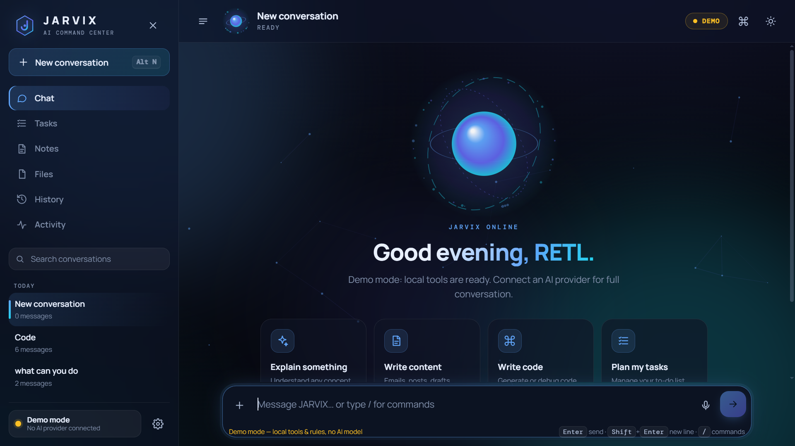
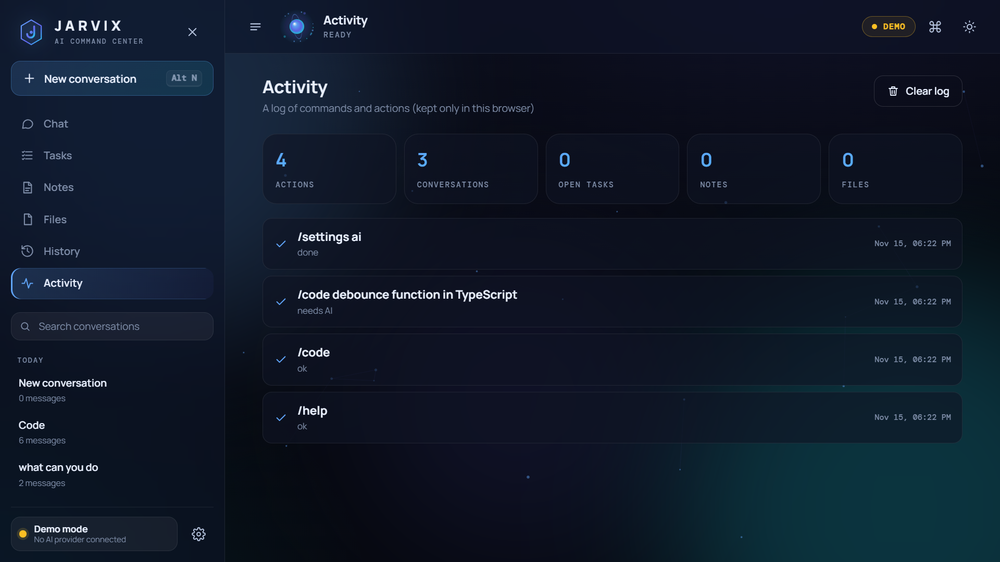
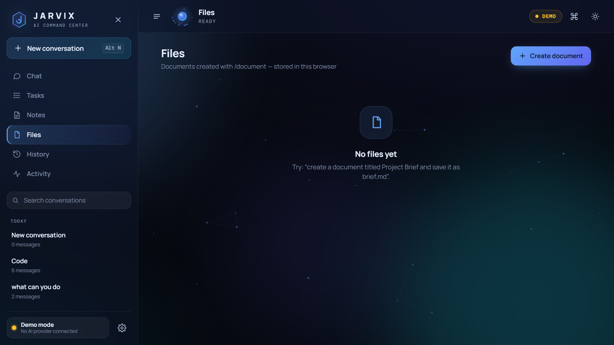
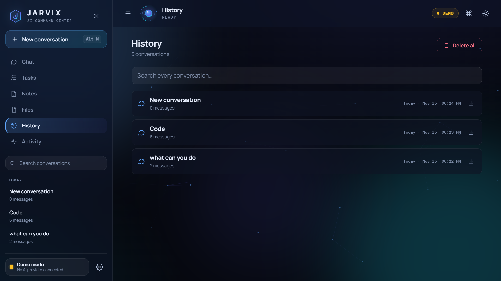
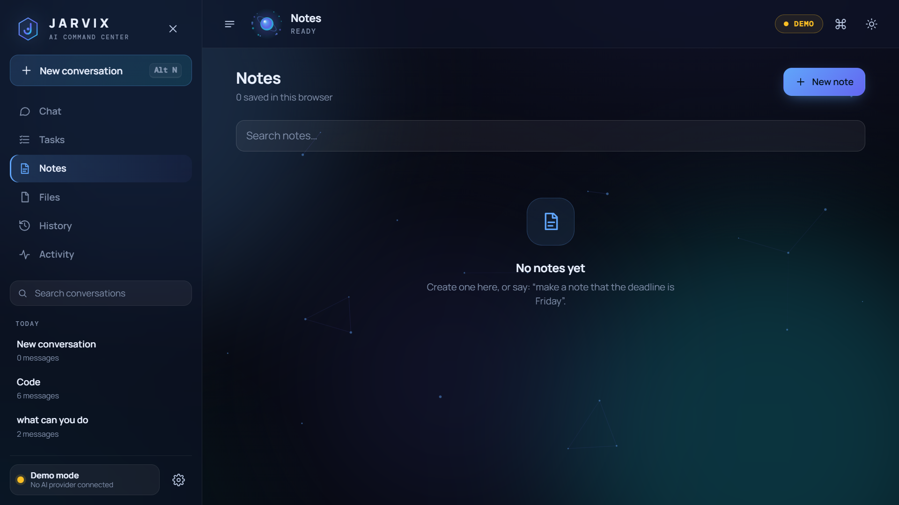
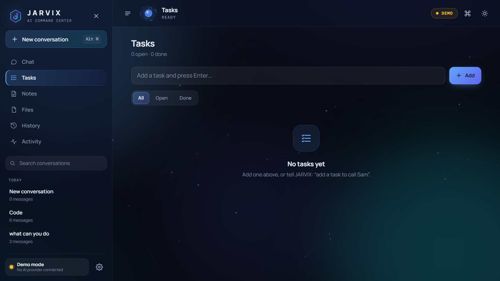
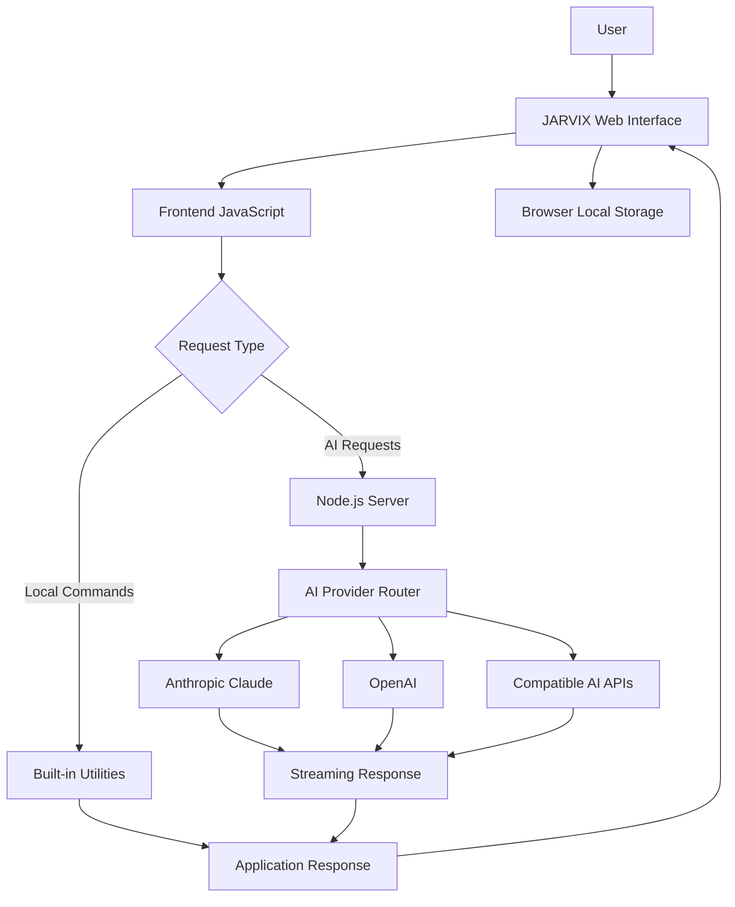

<div align="center">




<br>

<a href="https://github.com/rheillunio2-byte/JARVIX/stargazers"></a>
<a href="https://github.com/rheillunio2-byte/JARVIX/network/members"></a>
<a href="https://github.com/rheillunio2-byte/JARVIX/issues"></a>
<a href="https://github.com/rheillunio2-byte/JARVIX/blob/main/LICENSE"></a>

<br><br>

**YOUR INTELLIGENCE. YOUR ASSISTANT. YOUR JARVIX.**

*An intelligent personal assistant designed to bring conversations, productivity, and everyday digital tools into one unified command center.*

<br>

[Introduction](#-introduction) ·
[Preview](#-application-preview) ·
[Features](#-core-features) ·
[Tech Stack](#-technology-stack) ·
[Architecture](#-system-architecture) ·
[Installation](#-installation-and-setup) ·
[Roadmap](#-roadmap) ·
[Contributing](#-contributing)


</div>

## 🚀 Introduction


**JARVIX** is a personal AI assistant built as a local web application, combining conversational AI with practical productivity tools in a single interface.

Inspired by the concept of intelligent digital assistants, JARVIX aims to make everyday interactions more efficient through natural-language commands, AI-powered responses, voice interaction, and integrated workspace management.

Rather than functioning as just another chatbot, JARVIX connects conversations with useful actions and personal productivity features.

### 🎯 What Makes JARVIX Different?

- **Unified Workspace:** Chat, tasks, notes, files, history, and activity in one application.
- **Multiple AI Providers:** Connect Anthropic Claude, OpenAI, or OpenAI-compatible services.
- **Local Productivity Tools:** Perform calculations, conversions, task management, and other operations without requiring an AI API.
- **Privacy-Conscious Design:** Provider API keys remain on the server, while personal application data is stored locally in the browser.
- **Transparent AI Status:** Clearly distinguishes between LIVE AI connectivity and DEMO mode.
- **Voice Interaction:** Supports browser-based speech recognition and text-to-speech.

JARVIX is designed around one principle:

> Technology should not only respond to commands. It should help you accomplish things.

<br clear="right">

## 🖥️ Application Preview

<div align="center">



**The JARVIX Command Center**

<sub>A unified interface featuring the AI core, conversational workspace, quick actions, and command input.</sub>

</div>

## ✨ Core Features

JARVIX combines conversational intelligence, personal organization, and built-in utilities.

### 01. AI-Powered Chat

- Streaming AI responses through a server-side API.
- Supports Anthropic Claude, OpenAI, and compatible endpoints.
- Conversation context for follow-up questions.
- 39 slash commands with autocomplete and typo correction.
- Markdown rendering, tables, code highlighting, and mathematical expressions.
- Interactive flashcards and quizzes.
- Edit, regenerate, copy, stop, and export responses.
- Voice input and spoken responses.

### 02. Intelligent Command System

Interact with JARVIX using slash commands or natural-language instructions.

Examples:

| Command | Function |
|---|---|
| `/summarize` | Summarize information |
| `/translate` | Translate text |
| `/explain` | Explain complex topics |
| `/code` | Generate programming assistance |
| `/quiz` | Create interactive quizzes |
| `/todo add` | Add a task |
| `/note add` | Create a note |
| `/document` | Generate a document |

For the complete command reference, see [docs/commands.md](docs/commands.md).

### 03. Productivity Management

| Module | Capabilities |
|---|---|
| Chat | AI conversations and command execution |
| Tasks | Create, edit, complete, and organize tasks |
| Notes | Create, search, edit, and manage notes |
| Files | Access and export generated documents |
| History | Search, review, and export conversations |
| Activity | Track application actions and activity |

### 04. Built-in Utilities

- Calculator and mathematical operations.
- Unit conversion.
- Password generation.
- Date and time recognition.
- Natural-language task and note creation.
- Document generation and export.

### 05. Personalization & Experience

- Dark and light themes.
- Six accent color options.
- Adjustable font sizes.
- Four animation levels.
- Reduced-motion accessibility support.
- Optional interface sounds.
- Customizable assistant personality.
- Adjustable response length.
- Responsive desktop, tablet, and mobile layouts.

### 06. Voice & Interaction

- Browser-based speech-to-text.
- Text-to-speech responses.
- Microphone activation through user interaction.
- Keyboard shortcuts.
- Command palette with `Ctrl + K` or `Cmd + K`.

## 📸 Application Screenshots

<div align="center">

| Chat Interface | Activity Dashboard |
|:---:|:---:|
|  |  |
| **AI Conversations** | **Activity Tracking** |

| File Management | Conversation History |
|:---:|:---:|
|  |  |
| **Generated Documents** | **Saved Conversations** |

| Notes Management | Task Management |
|:---:|:---:|
|  |  |
| **Personal Notes** | **Task Organization** |

</div>

## 🛠️ Technology Stack

JARVIX uses a lightweight architecture built around native web technologies and Node.js, without requiring a frontend framework or external runtime dependencies.

<div align="center">

### Frontend Development


### Backend Development


### AI & Language Model Integration


</div>

### Detailed Technology Breakdown

| Category | Technologies |
|---|---|
| Frontend | HTML5, CSS3, Vanilla JavaScript |
| Backend | Node.js 18+ |
| Server | Native Node.js HTTP modules |
| AI Integration | Anthropic Messages API, OpenAI Chat Completions |
| Compatible AI | Ollama, LM Studio, OpenRouter, vLLM, Groq |
| Graphics | HTML Canvas 2D |
| Voice | Web Speech API |
| Audio | Web Audio API |
| Data Storage | Browser localStorage |
| Communication | REST API, Server-Sent Events (SSE) |
| Styling | Custom CSS, CSS Variables, Glassmorphism |
| Typography | Manrope, DM Mono |
| Testing | Node.js Test Runner, Playwright |
| Version Control | Git, GitHub |

**Development Philosophy:**
- No frontend frameworks.
- No bundlers or compilation requirements.
- No mandatory npm dependencies.
- Lightweight server-side architecture.
- Modular JavaScript organization.
- Local-first application data storage.

## 🏗️ System Architecture

JARVIX follows a lightweight client-server architecture.



### Architecture Highlights

- **Client Layer:** Handles the user interface, interactions, command recognition, and local utilities.
- **Server Layer:** Manages API requests, provider configuration, security controls, and streaming responses.
- **AI Provider Layer:** Routes requests to the configured AI service.
- **Storage Layer:** Maintains conversations, tasks, notes, settings, and application data in browser storage.

For more technical details:
- [System Architecture](docs/architecture.md)
- [AI Providers & Security](docs/providers-and-security.md)
- [Testing Documentation](docs/testing.md)

## ⚡ Installation and Setup

### Prerequisites

- Node.js 18 or newer.
- Git.
- A modern web browser.
- Optional: API key from a supported AI provider.

### 1. Clone the Repository

```bash
git clone https://github.com/rheillunio2-byte/JARVIX.git
```

### 2. Navigate to the Project

```bash
cd JARVIX
```

### 3. Start JARVIX

```bash
npm start
```

### 4. Open the Application

Navigate to:

```text
http://127.0.0.1:3000
```

**That's it!** JARVIX runs without requiring `npm install` because the project uses native Node.js modules and has no mandatory external dependencies.

## 🔌 AI Provider Configuration

JARVIX can operate in two modes.

| Mode | Description |
|---|---|
| DEMO | Uses a clearly labelled local rule-based responder. Built-in productivity tools remain available. |
| LIVE | Connects to a configured external AI provider for AI-powered responses. |

### Configure an AI Provider

Create your environment configuration file:

```bash
cp .env.example .env
```

Open `.env` and configure one provider.

**Anthropic Claude**

```env
JARVIX_PROVIDER=anthropic
ANTHROPIC_API_KEY=your-api-key
```

**OpenAI**

```env
JARVIX_PROVIDER=openai
OPENAI_API_KEY=your-api-key
```

**Ollama / OpenAI-Compatible API**

```env
JARVIX_PROVIDER=compatible
JARVIX_BASE_URL=http://localhost:11434/v1
JARVIX_MODEL=llama3.1
```

Restart the server after changing your configuration.

> [!IMPORTANT]
> Never commit your actual API keys. Keep `.env` private and ensure it remains excluded through `.gitignore`. JARVIX does not currently provide user authentication, so keep the server bound to localhost unless you configure appropriate access controls.

## 📁 Project Structure

```text
JARVIX/
│
├── images/
│   ├── jarvix-banner.svg
│   ├── jarvix-typing.svg
│   ├── jarvix-divider.svg
│   ├── jarvix-ai-core.svg
│   ├── jarvix-footer.svg
│   ├── Chat.PNG
│   ├── Activity.PNG
│   ├── Files.PNG
│   ├── History.PNG
│   ├── Noted.PNG
│   └── Tasks.PNG
│
├── server/
│   ├── server.js
│   ├── config.js
│   └── providers/
│       ├── anthropic.js
│       ├── openai.js
│       ├── shared.js
│       └── index.js
│
├── public/
│   ├── index.html
│   ├── css/
│   ├── js/
│   │   └── ui/
│   └── assets/
│       └── logo.svg
│
├── tests/
│   ├── unit tests
│   └── e2e/
│
├── docs/
│   ├── architecture.md
│   ├── commands.md
│   ├── providers-and-security.md
│   └── testing.md
│
├── scripts/
│   └── gen-docs.js
│
├── .env.example
├── .gitignore
├── package.json
├── CONTRIBUTING.md
└── LICENSE
```

## 🧪 Testing

JARVIX includes automated testing support.

### Unit Tests

```bash
npm test
```

Uses Node.js's built-in test runner.

### End-to-End Tests

```bash
npm i -D playwright
npx playwright install chromium
npm run test:e2e
```

Uses Playwright and Chromium for browser-level testing.

## 🗺️ Roadmap

JARVIX is an evolving project. The following roadmap separates existing functionality from future development.

### Implemented

- [x] AI chat with streaming responses.
- [x] Anthropic and OpenAI integrations.
- [x] OpenAI-compatible provider support.
- [x] Local demo mode.
- [x] 39 slash commands.
- [x] Natural-language command recognition.
- [x] Task and note management.
- [x] Document generation and file management.
- [x] Conversation history.
- [x] Activity tracking.
- [x] Voice input and text-to-speech.
- [x] Dark and light themes.
- [x] Customization and accessibility settings.
- [x] Data export and import.

### Planned Improvements

- [ ] Persistent long-term conversational memory.
- [ ] Hands-free voice interaction and wake-word support.
- [ ] Advanced task scheduling and reminders.
- [ ] Optional authentication and multi-user support.
- [ ] Calendar and email integrations.
- [ ] More advanced AI tool execution.
- [ ] Installable offline-capable application.
- [ ] Expanded integrations and automation capabilities.

Have an idea? Share it through [GitHub Issues](https://github.com/rheillunio2-byte/JARVIX/issues).

## 🔐 Privacy & Security

JARVIX is designed with a local-first approach.

- AI provider API keys are handled on the server.
- Browser requests communicate with JARVIX API endpoints.
- Personal application data is stored in browser localStorage.
- Built-in local commands do not require an external AI provider.
- API requests have configurable timeout and rate-limit controls.
- Environment variables are used for provider configuration.

**Important:** Local browser storage is not encrypted storage. Clearing browser data may remove saved application information. Avoid using JARVIX on untrusted shared devices.

## 🤝 Contributing

Contributions are welcome!

Whether you are interested in fixing bugs, improving the interface, adding features, or enhancing documentation, your contributions can help make JARVIX better.

### How to Contribute

1. Fork the repository.
2. Create a new feature branch.
3. Implement your changes.
4. Test your implementation.
5. Submit a Pull Request.

Please review [CONTRIBUTING.md](CONTRIBUTING.md) before submitting changes.

## 📜 License

JARVIX is released under the **MIT License**.

You are free to use, modify, and distribute this project according to the terms of the license.

See [LICENSE](LICENSE) for details.

## 👨‍💻 Developer

<div align="center">


### Rheil Evans Lunio

**Creator & Developer of JARVIX**

Computer Science Student | Software Developer | AI & Technology Enthusiast

<a href="https://github.com/rheillunio2-byte"></a>
<a href="https://github.com/rheillunio2-byte/JARVIX"></a>

<br>

*Building technology that makes everyday work smarter.*


**JARVIX — Beyond Conversation. Into Intelligent Assistance.**

<sub>Designed and developed by <a href="https://github.com/rheillunio2-byte">Rheil Evans Lunio</a> · MIT License</sub>

</div>
